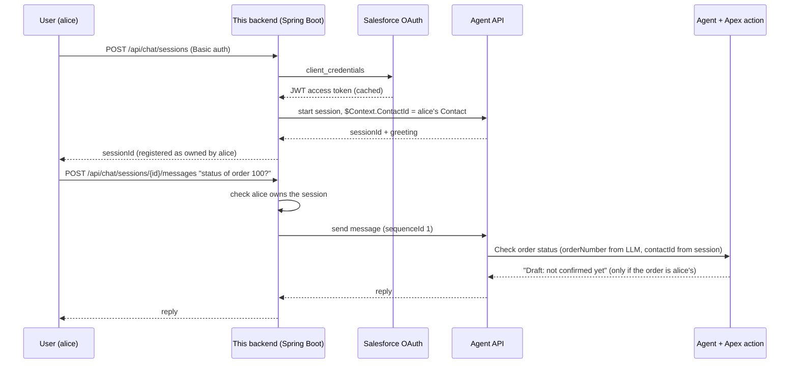

# Agentforce Order Agent: Java client for the Agent API

A Spring Boot backend that lets authenticated users chat with a **Salesforce Agentforce agent** through the **Agent API**, headless, with the customer's identity enforced end to end.

The agent answers order status questions by calling an Apex action. The interesting part is security: a customer can only ever see **their own** orders, no matter what they type and no matter which session ID they get hold of.



## Security design

Security is layered; no single layer is trusted on its own.

| Layer | Where | What it guarantees |
|---|---|---|
| Authentication | `SecurityConfig` | Every request comes from a known app user |
| Identity from the principal | `ChatService` | The Contact Id sent to the agent comes from the authenticated user, never from the request |
| Identity fixed per session | Agent API | `$Context.*` variables can only be set when the session starts |
| Identity bound outside the LLM | Agent Script | `with contactId = @variables.ContactId`: the model fills the order number, the platform fills the identity |
| Session ownership | `SessionRegistry` | A user can't send messages to (or end) someone else's session, which would let them talk to the agent as that customer |
| Record-level filter | Apex action | `WHERE BillToContactId IN :contactIds` with `USER_MODE`; no customer → "No order found" (fails closed) |
| No information leaks | Apex + `ApiExceptionHandler` | "Doesn't exist" and "not yours" return the same answer; Salesforce error bodies are logged, not returned |

## Tech

Java 25 · Spring Boot 4.2 (`RestClient`, Spring Security, Bean Validation, `@ConfigurationProperties` records) · JUnit 5 + Mockito + AssertJ · Salesforce Agentforce (Agent API, Agent Script, Apex).

## Project structure

```
config/    AgentforceProperties   typed settings from environment variables
           CustomerProperties     app user -> Salesforce Contact Id (demo mapping)
           SecurityConfig         HTTP Basic, demo users alice / bob
agentapi/  TokenProvider          OAuth client credentials, JWT token cache, refresh on 401
           AgentApiClient         start session, send message, end session
           AgentApiDtos           Agent API request/response records
chat/      ChatController         REST API: /api/chat/sessions
           ChatService            identity + ownership logic
           SessionRegistry        session owner and message sequence
           ApiExceptionHandler    errors as RFC 9457 problem details
```

## Salesforce setup

1. **Agent.** An Agentforce agent built in the new Agentforce Builder, with a subagent that calls the `OrderStatusAction` Apex action. The action input `contactId` is bound in Agent Script:
   ```
   Consultar_estado_de_pedido: @actions.Consultar_estado_de_pedido
       with orderNumber = ...
       with contactId = @variables.ContactId
   ```
   **Commit the version and activate it**: the Agent API only sees active versions.
2. **Agent user permissions.** A permission set for the agent's user with Apex Class Access to `OrderStatusAction`, Read on Orders and Accounts, and Read on the `Bill To Contact` field (required because the query runs in `USER_MODE`).
3. **External Client App** (Setup → External Client App Manager):
   - OAuth scopes: `api`, `refresh_token, offline_access`, `chatbot_api`, `sfap_api`.
   - Enable **Client Credentials Flow** and set a **Run As** user.
   - Enable **Issue JSON Web Token (JWT)-based access tokens for named users**. Without it you get a classic `00D...` token and the Agent API answers `404` with an empty body.
4. **Agent ID.** For agents built in the new builder, use the `BotDefinition` Id (starts with `0Xx`):
   ```bash
   sf data query -q "SELECT Id, DeveloperName FROM BotDefinition" -o <org-alias>
   ```

## Run it

Create a `.env` file in the project root (it's in `.gitignore`):

```bash
SF_DOMAIN=https://your-domain.my.salesforce.com
SF_CLIENT_ID=...
SF_CLIENT_SECRET=...
AGENT_ID=0Xx...
```

Map the demo users to real Contact Ids in `src/main/resources/application.properties` (`app.customers.alice`, `app.customers.bob`), then:

```bash
set -a; source .env; set +a
./mvnw spring-boot:run
```

## Try it

```bash
SID=$(curl -s -u alice:alice123 -X POST localhost:8080/api/chat/sessions | jq -r .sessionId)

# alice asks about her order -> "Draft: not confirmed yet"
curl -s -u alice:alice123 -X POST localhost:8080/api/chat/sessions/$SID/messages \
  -H "Content-Type: application/json" -d '{"text":"What is the status of order 100?"}'

# bob tries alice's session -> 404
curl -s -u bob:bob123 -X POST localhost:8080/api/chat/sessions/$SID/messages \
  -H "Content-Type: application/json" -d '{"text":"What is the status of order 100?"}'

# alice ends the session -> 204
curl -s -o /dev/null -w "%{http_code}\n" -u alice:alice123 -X DELETE localhost:8080/api/chat/sessions/$SID
```

| Endpoint | Description |
|---|---|
| `POST /api/chat/sessions` | Starts an agent session for the authenticated user |
| `POST /api/chat/sessions/{id}/messages` | Sends `{"text": "..."}` (max 2000 chars) |
| `DELETE /api/chat/sessions/{id}` | Ends the session |

## Tests

```bash
./mvnw test
```

Unit tests mock the Agent API, so they need no credentials and never call Salesforce. They cover identity (the authenticated user's Contact Id is used; unlinked users can't start), session ownership (other users can't send to or end a session, and the agent is never called when they try), sequence IDs, and response mapping.

## Troubleshooting

| Symptom | Cause | Fix |
|---|---|---|
| `404` with empty body on start session | Token isn't a JWT (starts with `00D`) | Enable JWT-based access tokens in the External Client App |
| `Bot ... has no active version` | Agent saved but not committed/activated | Commit Version, then Activate |
| Agent always says "No order found" | Identity variable not reaching the action | Use the name `$Context.ContactId`; unknown variable names are ignored silently |
| `NO_USER_ACCESS` / `sObject type 'Order' is not supported` | Agent user lacks permissions | Apex class access + object/field read in a permission set |

## Notes

The demo users (`{noop}` passwords) and the user → Contact mapping in properties are for local development only. In production, authenticate with your identity provider and store the customer link in your user database. `SessionRegistry` is in memory; with more than one instance, move it to Redis or a database.
